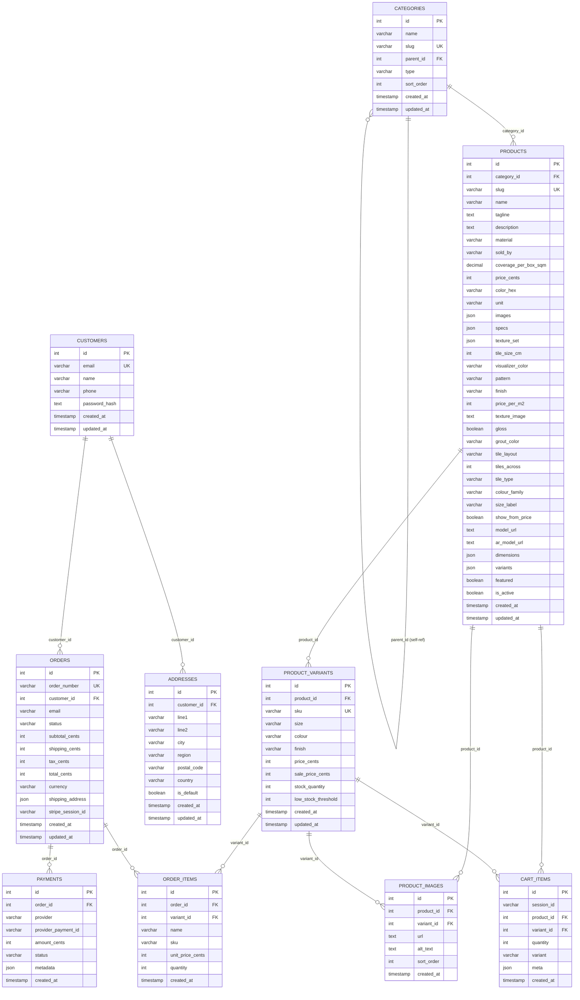

# Database Design — Clay & Co.

This document provides the complete database design for the Clay & Co. e-commerce platform based on `src/db/schema.ts`, MySQL DDL migrations, and runtime verification scripts.

---

## 1. Overview
- **Database Engine:** MySQL 8.0.43 (InnoDB engine)
- **Database Name:** `app_db`
- **Default Character Set:** `utf8mb4`
- **Default Collation:** `utf8mb4_unicode_ci`
- **ORM:** Drizzle ORM (`drizzle-orm/mysql-core`)
- **Total Tables:** 10 application domain tables + 1 Drizzle migration tracking table (`__drizzle_migrations`)

---

## 2. Entity-Relationship (ER) Diagram

---

## 3. Data Dictionary & Table Schemas

### 3.1 `categories`
Stores product taxonomy for both tiles and furniture.
| Field | Type | Nullable | Default | Description |
|---|---|---|---|---|
| `id` | `int` | No | AUTO_INCREMENT | Primary Key |
| `name` | `varchar(255)` | No | — | Human-readable category title |
| `slug` | `varchar(255)` | No | — | Unique URL-friendly slug |
| `parent_id` | `int` | Yes | `NULL` | Parent category ID for hierarchical nesting |
| `type` | `varchar(50)` | No | — | Category discriminator (`"tile"` \| `"furniture"`) |
| `sort_order` | `int` | No | `0` | Display sorting priority |
| `created_at` | `timestamp` | No | `CURRENT_TIMESTAMP` | Creation timestamp |
| `updated_at` | `timestamp` | No | `CURRENT_TIMESTAMP ON UPDATE` | Last update timestamp |

- **Indexes:** `categories_slug_idx` on (`slug`)

---

### 3.2 `products`
Unified table storing both ceramic tiles and architectural furniture. Category-specific visual attributes live in dedicated columns or JSON objects.
| Field | Type | Nullable | Default | Description |
|---|---|---|---|---|
| `id` | `int` | No | AUTO_INCREMENT | Primary Key |
| `category_id` | `int` | Yes | `NULL` | Foreign key referencing `categories(id)`. ON DELETE SET NULL |
| `slug` | `varchar(255)` | No | — | Unique product URL slug |
| `name` | `varchar(500)` | No | — | Product title |
| `tagline` | `text` | No | — | Short marketing tagline |
| `description` | `text` | No | — | Full markdown/HTML product description |
| `material` | `varchar(255)` | Yes | `NULL` | Material specification (e.g., Ceramic, Porcelain, Solid Oak) |
| `sold_by` | `varchar(50)` | No | `'piece'` | Sales unit: `'box'`, `'square_metre'`, or `'piece'` |
| `coverage_per_box_sqm` | `decimal(10,4)` | Yes | `NULL` | Area coverage per box in square meters |
| `price_cents` | `int` | No | — | Base price in cents (USD) |
| `color_hex` | `varchar(20)` | No | `'#cccccc'` | Primary color hex code |
| `unit` | `varchar(50)` | No | `'each'` | Unit label: `'per tile'`, `'per sqm'`, or `'each'` |
| `images` | `json` | No | — | Array of image URLs (`string[]`) |
| `specs` | `json` | No | — | Key-value technical specifications (`Record<string, string>`) |
| `texture_set` | `json` | Yes | `NULL` | Relative paths to PBR textures (`{ albedo, normal, roughness }`) |
| `tile_size_cm` | `int` | Yes | `NULL` | Tile dimension in centimeters (e.g., 20) |
| `visualizer_color` | `varchar(20)` | Yes | `NULL` | Hex color used for procedural visualizer shaders |
| `pattern` | `varchar(50)` | Yes | `NULL` | Pattern name: `'plain'`, `'speck'`, `'marble'`, `'glaze'`, `'wood'` |
| `finish` | `varchar(50)` | Yes | `NULL` | Surface finish: `'gloss'`, `'matte'`, `'natural'`, `'satin'` |
| `price_per_m2` | `int` | Yes | `NULL` | Price per square meter in cents |
| `texture_image` | `text` | Yes | `NULL` | Optional image URL override for 3D textures |
| `gloss` | `boolean` | No | `false` | Flag indicating high gloss reflective finish |
| `grout_color` | `varchar(20)` | Yes | `NULL` | Hex grout color code for procedural rendering |
| `tile_layout` | `varchar(20)` | Yes | `NULL` | Default layout: `'straight'` or `'herringbone'` |
| `tiles_across` | `int` | Yes | `NULL` | Number of tiles shown across card thumbnail |
| `tile_type` | `varchar(30)` | Yes | `NULL` | Display badge: `'Gloss'`, `'Matte'`, `'Natural'`, `'Mosaic'` |
| `colour_family` | `varchar(30)` | Yes | `NULL` | Filter group: `'White'`, `'Beige'`, `'Grey'`, `'Charcoal'`, etc. |
| `size_label` | `varchar(30)` | Yes | `NULL` | Dimension label (e.g., `'20×20'`) |
| `show_from_price` | `boolean` | No | `false` | When true, renders "From $X" on catalog cards |
| `model_url` | `text` | Yes | `NULL` | Path to GLB 3D binary file in `/public/models/` |
| `ar_model_url` | `text` | Yes | `NULL` | Path to iOS USDZ file |
| `dimensions` | `json` | Yes | `NULL` | Physical dimensions `{ width, height, depth }` in cm |
| `variants` | `json` | No | — | Legacy variant list `{ name, colorHex, targetMesh }[]` |
| `featured` | `boolean` | No | `false` | Highlighted on homepage showcases |
| `is_active` | `boolean` | No | `true` | Visibility toggle |
| `created_at` | `timestamp` | No | `CURRENT_TIMESTAMP` | Creation timestamp |
| `updated_at` | `timestamp` | No | `CURRENT_TIMESTAMP ON UPDATE` | Last update timestamp |

- **Indexes:** `products_slug_idx` on (`slug`), `products_category_idx` on (`category_id`)

---

### 3.3 `product_variants`
Tracks SKU-level inventory, discrete sizes, colors, and prices.
| Field | Type | Nullable | Default | Description |
|---|---|---|---|---|
| `id` | `int` | No | AUTO_INCREMENT | Primary Key |
| `product_id` | `int` | No | — | Foreign key referencing `products(id)`. ON DELETE CASCADE |
| `sku` | `varchar(100)` | No | — | Unique SKU code (e.g., `'CLAY-WHT-2020'`) |
| `size` | `varchar(100)` | Yes | `NULL` | Specific variant size (e.g., `'20×20 cm'`) |
| `colour` | `varchar(100)` | Yes | `NULL` | Specific variant colour (e.g., `'Terracotta'`) |
| `finish` | `varchar(100)` | Yes | `NULL` | Specific variant finish (e.g., `'Gloss'`) |
| `price_cents` | `int` | No | — | Variant retail price in cents |
| `sale_price_cents` | `int` | Yes | `NULL` | Optional discounted price in cents |
| `stock_quantity` | `int` | No | `0` | Available inventory count |
| `low_stock_threshold` | `int` | No | `10` | Threshold triggering low-stock alerts |
| `created_at` | `timestamp` | No | `CURRENT_TIMESTAMP` | Creation timestamp |
| `updated_at` | `timestamp` | No | `CURRENT_TIMESTAMP ON UPDATE` | Last update timestamp |

- **Indexes:** `product_variants_sku_idx` on (`sku`), `product_variants_product_idx` on (`product_id`)

---

### 3.4 `product_images`
Manages supplementary product and variant imagery.
| Field | Type | Nullable | Default | Description |
|---|---|---|---|---|
| `id` | `int` | No | AUTO_INCREMENT | Primary Key |
| `product_id` | `int` | No | — | Foreign key referencing `products(id)`. ON DELETE CASCADE |
| `variant_id` | `int` | Yes | `NULL` | Optional FK referencing `product_variants(id)`. ON DELETE CASCADE |
| `url` | `text` | No | — | Asset URL |
| `alt_text` | `text` | No | — | Accessibility descriptive text |
| `sort_order` | `int` | No | `0` | Display gallery order |
| `created_at` | `timestamp` | No | `CURRENT_TIMESTAMP` | Creation timestamp |

- **Indexes:** `product_images_product_idx` on (`product_id`), `product_images_variant_idx` on (`variant_id`)

---

### 3.5 `customers`
Stores registered customer accounts and profile data.
| Field | Type | Nullable | Default | Description |
|---|---|---|---|---|
| `id` | `int` | No | AUTO_INCREMENT | Primary Key |
| `email` | `varchar(255)` | No | — | Unique customer email address |
| `name` | `varchar(255)` | No | — | Full customer name |
| `phone` | `varchar(50)` | Yes | `NULL` | Contact phone number |
| `password_hash` | `text` | Yes | `NULL` | Password hash for future user authentication |
| `created_at` | `timestamp` | No | `CURRENT_TIMESTAMP` | Account creation date |
| `updated_at` | `timestamp` | No | `CURRENT_TIMESTAMP ON UPDATE` | Account update date |

- **Indexes:** `customers_email_idx` on (`email`)

---

### 3.6 `addresses`
Delivery and billing addresses associated with customers.
| Field | Type | Nullable | Default | Description |
|---|---|---|---|---|
| `id` | `int` | No | AUTO_INCREMENT | Primary Key |
| `customer_id` | `int` | No | — | Foreign key referencing `customers(id)`. ON DELETE CASCADE |
| `line1` | `varchar(500)` | No | — | Street address line 1 |
| `line2` | `varchar(500)` | Yes | `NULL` | Apartment, suite, unit |
| `city` | `varchar(255)` | No | — | City name |
| `region` | `varchar(255)` | No | — | State or province |
| `postal_code` | `varchar(50)` | No | — | Postal or ZIP code |
| `country` | `varchar(100)` | No | `'US'` | Country code or name |
| `is_default` | `boolean` | No | `false` | Default shipping address flag |
| `created_at` | `timestamp` | No | `CURRENT_TIMESTAMP` | Creation timestamp |
| `updated_at` | `timestamp` | No | `CURRENT_TIMESTAMP ON UPDATE` | Update timestamp |

- **Indexes:** `addresses_customer_idx` on (`customer_id`)

---

### 3.7 `orders`
Master order records generated during checkout.
| Field | Type | Nullable | Default | Description |
|---|---|---|---|---|
| `id` | `int` | No | AUTO_INCREMENT | Primary Key |
| `order_number` | `varchar(100)` | No | — | Unique order code (e.g., `'CLAY-49201'`) |
| `customer_id` | `int` | Yes | `NULL` | FK referencing `customers(id)`. ON DELETE SET NULL |
| `email` | `varchar(255)` | No | — | Order confirmation contact email |
| `status` | `varchar(50)` | No | `'pending'` | Lifecycle: `'pending'`, `'paid'`, `'packed'`, `'shipped'`, `'delivered'`, `'cancelled'`, `'refunded'` |
| `subtotal_cents` | `int` | No | — | Order subtotal in cents |
| `shipping_cents` | `int` | No | `0` | Shipping freight cost in cents |
| `tax_cents` | `int` | No | `0` | Sales tax in cents (calculated at 8%) |
| `total_cents` | `int` | No | — | Total charges in cents |
| `currency` | `varchar(10)` | No | `'USD'` | Currency ISO code |
| `shipping_address` | `json` | No | — | Address snapshot `{ name, line1, line2, city, region, postalCode, country }` |
| `stripe_session_id` | `varchar(500)` | Yes | `NULL` | External Stripe checkout session identifier |
| `created_at` | `timestamp` | No | `CURRENT_TIMESTAMP` | Order timestamp |
| `updated_at` | `timestamp` | No | `CURRENT_TIMESTAMP ON UPDATE` | Status update timestamp |

- **Indexes:** `orders_order_number_idx` on (`order_number`), `orders_email_idx` on (`email`), `orders_customer_idx` on (`customer_id`), `orders_status_idx` on (`status`)

---

### 3.8 `order_items`
Immutable line-item snapshots preserved at the moment of order placement.
| Field | Type | Nullable | Default | Description |
|---|---|---|---|---|
| `id` | `int` | No | AUTO_INCREMENT | Primary Key |
| `order_id` | `int` | No | — | Foreign key referencing `orders(id)`. ON DELETE CASCADE |
| `variant_id` | `int` | Yes | `NULL` | FK referencing `product_variants(id)`. ON DELETE SET NULL |
| `name` | `varchar(500)` | No | — | Product name snapshot |
| `sku` | `varchar(100)` | No | — | SKU or slug snapshot |
| `unit_price_cents`| `int` | No | — | Unit price snapshot at purchase time |
| `quantity` | `int` | No | — | Ordered quantity |
| `created_at` | `timestamp` | No | `CURRENT_TIMESTAMP` | Insertion timestamp |

- **Indexes:** `order_items_order_idx` on (`order_id`)

---

### 3.9 `payments`
Tracks payment provider transaction logs and settlement states.
| Field | Type | Nullable | Default | Description |
|---|---|---|---|---|
| `id` | `int` | No | AUTO_INCREMENT | Primary Key |
| `order_id` | `int` | No | — | Foreign key referencing `orders(id)`. ON DELETE CASCADE |
| `provider` | `varchar(100)` | No | `'stripe'` | Gateway provider name (`'stripe'`, `'paypal'`) |
| `provider_payment_id` | `varchar(500)` | No | — | Payment intent / transaction ID |
| `amount_cents` | `int` | No | — | Paid amount in cents |
| `status` | `varchar(50)` | No | `'pending'` | Status: `'pending'`, `'succeeded'`, `'failed'`, `'refunded'` |
| `metadata` | `json` | Yes | `NULL` | Raw webhook / transaction metadata |
| `created_at` | `timestamp` | No | `CURRENT_TIMESTAMP` | Transaction timestamp |

- **Indexes:** `payments_order_idx` on (`order_id`), `payments_provider_payment_idx` on (`provider_payment_id`)

---

### 3.10 `cart_items`
Persists active shopping cart items for guest and registered users.
| Field | Type | Nullable | Default | Description |
|---|---|---|---|---|
| `id` | `int` | No | AUTO_INCREMENT | Primary Key |
| `session_id` | `varchar(255)` | No | — | Guest cookie session UUID (`cart_session`) |
| `product_id` | `int` | No | — | Foreign key referencing `products(id)`. ON DELETE CASCADE |
| `variant_id` | `int` | Yes | `NULL` | Foreign key referencing `product_variants(id)`. ON DELETE CASCADE |
| `quantity` | `int` | No | `1` | Quantity added to cart |
| `variant` | `varchar(255)` | Yes | `NULL` | Legacy variant string label |
| `meta` | `json` | Yes | `NULL` | Custom visualizer context (layout, grout, area, room) |
| `created_at` | `timestamp` | No | `CURRENT_TIMESTAMP` | Insertion timestamp |
