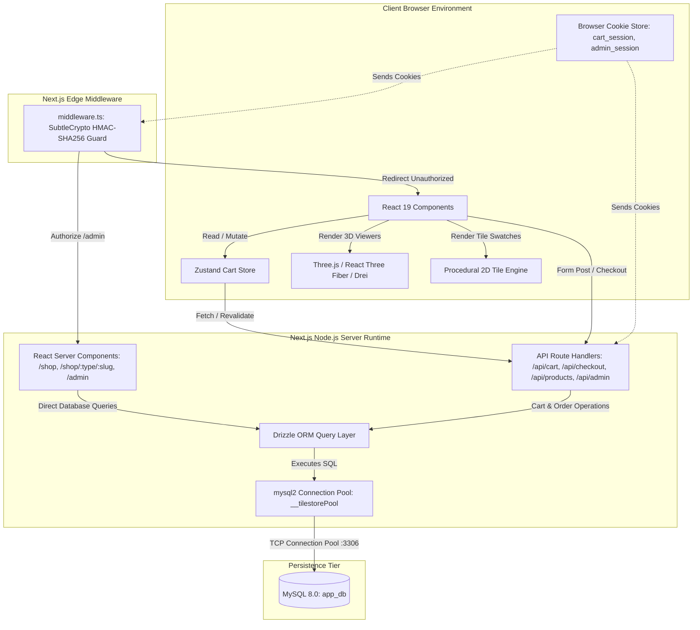
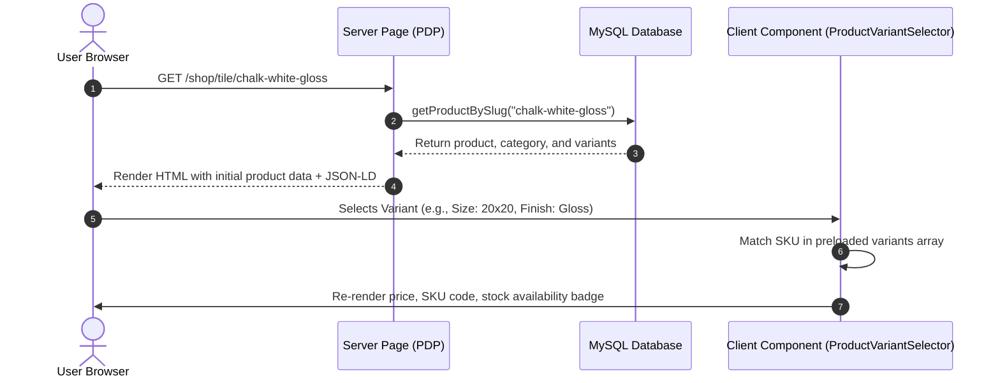
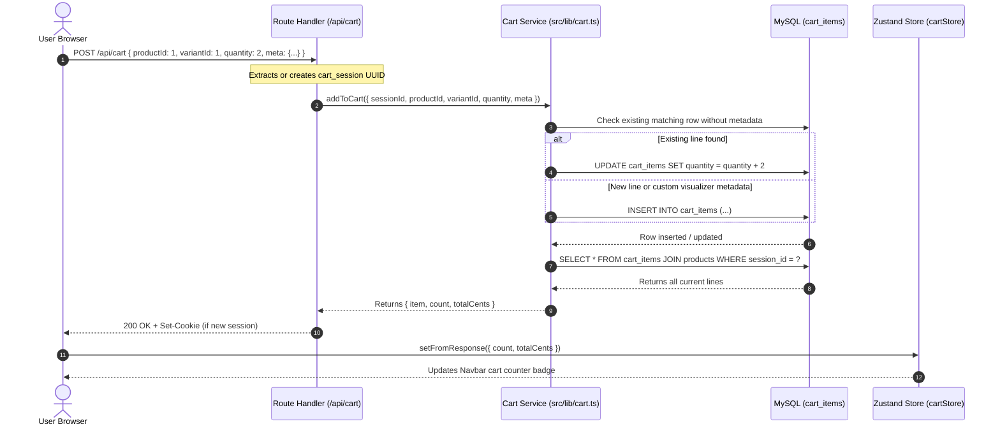
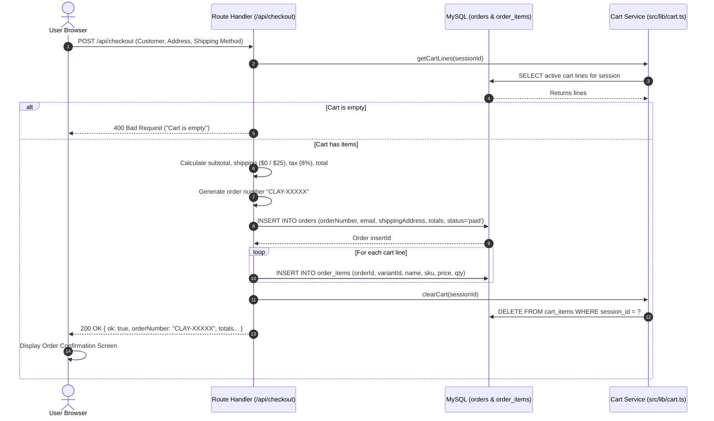

# System Design — Clay & Co.

This document outlines the system architecture, component boundaries, execution runtimes, data flow pipelines, and session management protocols of the Clay & Co. e-commerce platform.

---

## 1. High-Level System Architecture

Clay & Co. is architected as a hybrid full-stack application built on **Next.js 16 (App Router)** with **Turbopack**, backed by a **MySQL 8.0** relational database.

---

## 2. Architectural Tiers & Communication Protocols

### 2.1 Frontend Tier (Client Browser)
- **React Server Components (RSC) vs. Client Components:**
  - High-level layout pages (`src/app/shop/page.tsx`, `src/app/shop/[type]/[slug]/page.tsx`, `src/app/admin/page.tsx`) run as **Server Components**, querying the database directly with zero client JavaScript overhead for initial data loading.
  - Interactive nodes (`Hero3D.tsx`, `RoomVisualizerNew.tsx`, `FurnitureViewer.tsx`, `TileImage.tsx`, `AddToCartForm.tsx`, `ProductVariantSelector.tsx`) are marked with `"use client"` and dynamically imported with `{ ssr: false }` to isolate WebGL canvas lifecycle from the server.
- **Client-Side State Synchronization:**
  - `src/store/cartStore.ts`: Zustand store managing badge counter (`count`), current total (`totalCents`), and hydration flags.
  - Whenever an "Add to Cart", quantity update, or item removal occurs, the client invokes the corresponding Route Handler and updates the Zustand store from the server JSON response.

### 2.2 Security & Edge Middleware Tier
- **Edge Middleware (`src/middleware.ts`):**
  - Targets `/admin/:path*` (excluding `/admin/login`).
  - Executes on the **Edge Runtime** (lightweight V8 isolate, no `node:crypto`).
  - Utilizes Web Crypto API `crypto.subtle` to perform HMAC-SHA256 signature verification and timing-safe constant-time bitwise comparisons on the `admin_session` token (`admin:<timestamp>.<signature>`).
  - Redirects invalid or expired sessions immediately to `/admin/login?from=<path>`.

### 2.3 Backend & Route Handler Tier
- **Route Handlers (`src/app/api/*`):**
  - Run on the **Node.js Server Runtime**.
  - Handles state mutations and JSON communications for cart management, checkout submissions, and authentication.
- **Session Resolution:**
  - Guest Cart: `src/lib/session.ts` extracts `cart_session` from incoming cookies or generates a `crypto.randomUUID()` attached to the outgoing `Set-Cookie` header with a 90-day lifespan.
  - Admin: `src/lib/admin-session.ts` signs payloads with `process.env.ADMIN_SESSION_SECRET` using Node.js `node:crypto` (`createHmac`).

### 2.4 Data Access Tier
- **Connection Pooling (`src/db/index.ts`):**
  - Uses `mysql2/promise` with global singleton memoization (`globalThis.__tilestorePool` and `globalThis.__tilestoreDb`). This prevents socket exhaustion during Next.js Turbopack hot-module reloads.
- **Type-Safe Queries (`src/db/queries.ts`):**
  - Built using Drizzle ORM query builders (`db.select().from(...).where(...)`).
  - Joins products, categories, and SKU variants with strongly typed results (`ProductWithDetails`).

---

## 3. Core Data Flow Pipelines

### 3.1 Product Detail & Variant Selection Flow

---

### 3.2 Add to Cart & Persistence Flow

---

### 3.3 Checkout & Order Creation Flow

